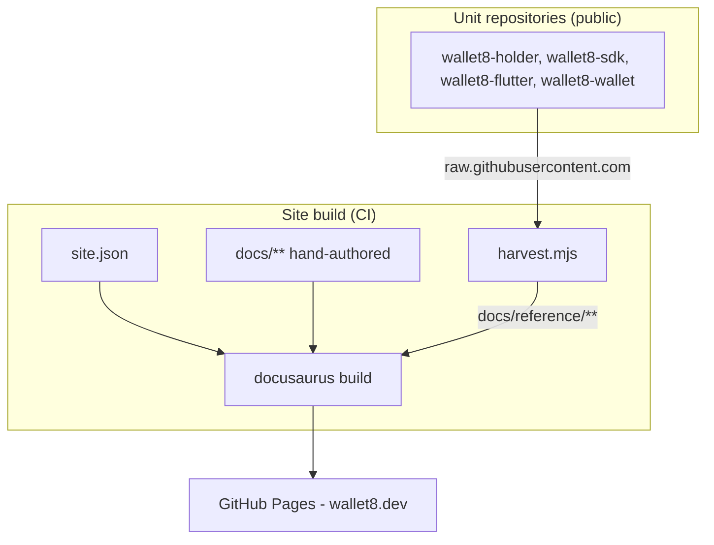

# Wallet8:Site - Detailed Design Document

## 1. Scope & Context

wallet8.dev is the Wallet8 vertical's public website. It owns the
marketing and documentation surface of the vertical: the landing page,
the per-unit dossier pages, the security posture, the developer guide,
the samples, and the harvested reference tree.

It does NOT own the documentation content itself - every unit repository
stays the source of truth, and the harvester renders that content at
build time.

## 2. Runtime Architecture

The site is a static Docusaurus build produced by the shared engine
`@sentin8/site-engine`:

| Component | Role |
|---|---|
| `site.json` | the vertical inventory: identity, hero copy, accent, pillars, units, apps, SDKs, showcase |
| `src/pages/index.jsx` | the data-driven landing (hero, start-here, card grids, pillars, showcase) |
| `docs/**` | hand-authored pages: overview, products, apps, SDKs, security, developers, samples, legal |
| `harvest.mjs` | renders `docs/reference/**` from the unit repositories |
| `makeSiteConfig()` | emits the full Docusaurus config (navbar, footer, search, Mermaid, OpenAPI layer) |

## 3. Data Model

`site.json` is the only site-local data source.

| Field | Role |
|---|---|
| `vertical` / `name` / `org` / `domain` | identity and the GitHub org the unit repos live in |
| `tagline` | short line, used for the page meta description |
| `heroEyebrow` / `heroTitle` / `heroDescription` | landing hero eyebrow, positioning title, long business description |
| `accent` | the wallet gold `#F8B64C` |
| `pillars[5]` / `pillarsLead` | the wallet invariants strip |
| `units[1]` | the holder service |
| `apps[1]` | the reference wallet |
| `sdks[2]` | the Rust and Flutter SDKs |
| `showcase[]` / `showcaseLead` | the family cards (Sentin8, Bank8) |
| `crossrefs[]` | cross-site links |

## 4. API Surface

The site serves static routes only. It has no runtime API of its own: the
interactive API reference pages are generated at build time from each
unit's OpenAPI spec (when a unit ships one) under `/docs/api/{unit}/**`.

| Route family | Source |
|---|---|
| `/` | `src/pages/index.jsx` + `site.json` |
| `/docs/**` | hand-authored MDX/markdown |
| `/docs/reference/**` | `harvest.mjs` output (gitignored) |
| `/docs/api/**` | `docusaurus-plugin-openapi-docs` output (gitignored) |
| `/privacy`, `/terms` | `src/pages/*.md` |

## 5. Cross-Cutting Concerns

| Concern | How it is satisfied |
|---|---|
| Tenant isolation | not applicable: the site is static content, no database, no tenant data |
| Authentication | the site holds no credentials and no tokens; the wallet app's tokens stay server-side in Sentin8:BFF |
| Secret handling | none: the build reads public repositories only |
| Audit | the unit repositories' own histories are the audit trail of the content |
| TLS | served by GitHub Pages; the product's post-quantum TLS is documented on the security page, not implemented by the marketing site |
| Broken links | `onBrokenLinks: throw` - the build fails rather than shipping a dead route |

## 6. Failure Modes & Recovery

| Failure | Behavior |
|---|---|
| A unit repository is private or unreachable | harvest fails the build; the deploy does not happen |
| A harvested doc contains a broken repo-relative link | the harvester re-points it to the GitHub URL; a genuinely broken link fails the build |
| A generated API page is stale | `harvest` regenerates the tree from the current spec on every build |
| A deploy is cancelled | rerun the workflow via `workflow_dispatch` |

## 7. Concurrency & Performance Model

The site has no runtime concurrency: it is a static bundle served by a
CDN. Build time is dominated by the harvest fetch and the Docusaurus
webpack build.

## 8. Invariants, Insecure-Defaults Rejected

1. The site never publishes an API surface that a unit repo does not
   declare - every API page descends from a checked-in spec.
2. The site never duplicates a unit's documentation - it harvests it.
3. The site holds no credential, no token, and no secret.
4. The site is built from public sources only.

## 9. Testing Strategy

| Layer | Covers |
|---|---|
| Build | `npm run build` - broken links, MDX validity, sidebar integrity |
| Engine tests | `sentin8-site-engine` unit tests (roster, config factory, harvester helpers) |
| Visual check | the operator opens a representative route per section |

There is no E2E suite: the site has no interactive runtime behavior of
its own beyond navigation.

## 10. Open Questions

- The holder service does not yet ship a checked-in OpenAPI dump, so the
  interactive API reference section is absent until it does.
- The reference wallet's repository README is still the Flutter
  template text; the harvested overview page will improve when the repo
  ships its own.
