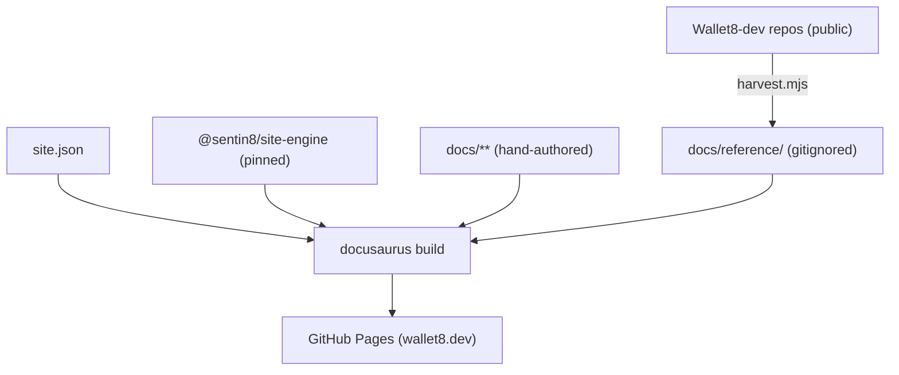

# Wallet8:Site - wallet8.dev
[](LICENSE)
[](https://www.rust-lang.org/)
[](https://wallet8.dev/)

> The Wallet8 public website at [wallet8.dev](https://wallet8.dev): the
> wallet role of the digital-credential stack, its holder service, the
> reference wallet app, and both SDKs - with the wallet's own invariants
> and the inherited security posture front and center. Built on
> `@sentin8/site-engine` (Docusaurus v3). Program design of record:
> `design/sentin8-websites-design.md` (WEB §4.5).

## 1. Summary

wallet8.dev is the Wallet8 vertical's product site: a landing page
detailing the holder service, the reference wallet app, and the two
SDKs, per-product pages with use cases and API surfaces, the vertical's
security invariants, developer lifecycle, samples, and a **Reference**
section harvested at build time from each unit repo's own docs - the
repositories stay the source of truth.

## 2. Motivation

A wallet's guarantees are the product: consent before any data is shown,
credentials sealed at rest, proofs bound to the device, and revocation
awareness. This site is that layer, harvested so the published story
never drifts from the code that implements the specifications.

## 3. Architecture



## 4. Content map

| Route | Content |
|---|---|
| `/` | Hero - product cards - app - SDKs - invariant pillars - platform showcase |
| `/docs/` | Vertical overview |
| `/docs/products/holder` | The holder backend: use cases, orchestration, data model |
| `/docs/apps/wallet` | The reference wallet: surfaces, DC API shim |
| `/docs/sdk/{runtime,flutter}` | Both SDKs |
| `/docs/security/` | Vertical invariants + inherited platform pillars |
| `/docs/developers/` - `/docs/samples/` | Dev story - the two rounds |
| `/docs/reference/{unit}/` | Harvested README/DESIGN/BUSINESS per unit |
| `/privacy` - `/terms` | Vertical legal pages (also every footer legal link target) |

## 5. Development

```bash
npm install
npm run harvest   # renders docs/reference/ from sibling repos (offline)
npm start
npm run build     # fails on broken links
```

Adding a unit: edit `site.json` -> add the hand-authored page -> the
harvester picks up the repo trio automatically.

## 6. Deployment

Push to `main` -> `ci.yml` calls `Sentin8/sentin8-ci site.yml@ci-v3` ->
harvest -> build -> GitHub Pages. Weekly scheduled rebuild refreshes
harvested content. Custom domain via `static/CNAME` (operator DNS step).

---

**Architecture & Design:** Wallet8:Site and its underlying concepts were
designed by [Hamid Jahanzad](https://www.linkedin.com/in/hamidjahanzad/).
