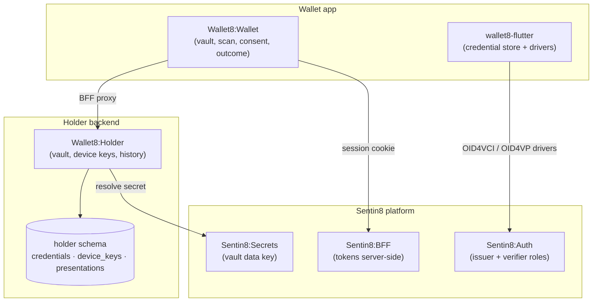

# Wallet8 - the digital wallet vertical

Wallet8 is the **wallet role** of the Sentin8 digital-credential stack,
shipped as a first-class vertical: the reusable wallet platform other
verticals (bank8, hotel8, health8, ...) build their own branded wallets
on.

It holds verifiable credentials in an encrypted vault, intakes an
issuer's Credential Offer, and presents the minimum claim set a verifier
asked for - implemented section by section from the normative
specifications rather than approximated.

## The products

| Product | Role |
|---|---|
| [Holder](/docs/products/holder) | the backend - sealed credential vault, device keys, issuance and presentation orchestration |
| [Wallet](/docs/apps/wallet) | the reference wallet app - vault, scan intake, consent preview, outcome |
| [wallet8 Rust SDK](/docs/sdk/runtime) | the OID4VCI + OID4VP client libraries and holder contracts |
| [wallet8 Flutter SDK](/docs/sdk/flutter) | what a vertical's branded wallet embeds |

## What the wallet does

- **Credential intake** - scan an issuer's Credential Offer (QR or deep
  link), complete the OID4VCI authorization, and store the credential in
  the vault.
- **Credential vault** - the user's credentials, sealed with AES-256-GCM
  at rest, listed in the app.
- **Presentation** - scan a verifier's Authorization Request, see the
  exact requested claims, consent, and present.
- **Selective disclosure** - present only the claims the verifier asked
  for, never the whole credential.
- **Device binding** - the wallet's key registers once (public half
  only); credentials bind to the device through proofs.
- **Revocation awareness** - the status sync walks the Token Status List;
  a revoked credential stops presenting.
- **History** - every verification event is recorded: who saw what, when.

## Standards

| Standard | Role |
|---|---|
| OID4VCI 1.0 (Final) | issuance client - offers, both grant flows, nonce, proofs, deferred, notifications |
| OID4VP 1.0 (Final) | presentation client - JAR verification, Client Identifier Prefixes, DCQL, `direct_post`, encrypted responses, DC API |
| IETF SD-JWT VC | the `dc+sd-jwt` credential format |
| ISO/IEC 18013-5/-7 | the `mso_mdoc` credential format |
| IETF Token Status List | revocation awareness |
| OIDF HAIP 1.0 | the interoperability profile the wallet is certified against |

## Security

Wallet8 inherits the platform's five pillars - post-quantum TLS, one
identity plane, live authorization, mandatory tenant isolation, and
certificate-only workload identity - and adds the wallet role's own
guarantees. Read [Security](/docs/security) for the full posture.

## Not owned by Wallet8

The issuer role, the verifier role, and the mdoc wire engine live in
Sentin8:Auth and the platform SDK. Wallet8 is the wallet.
