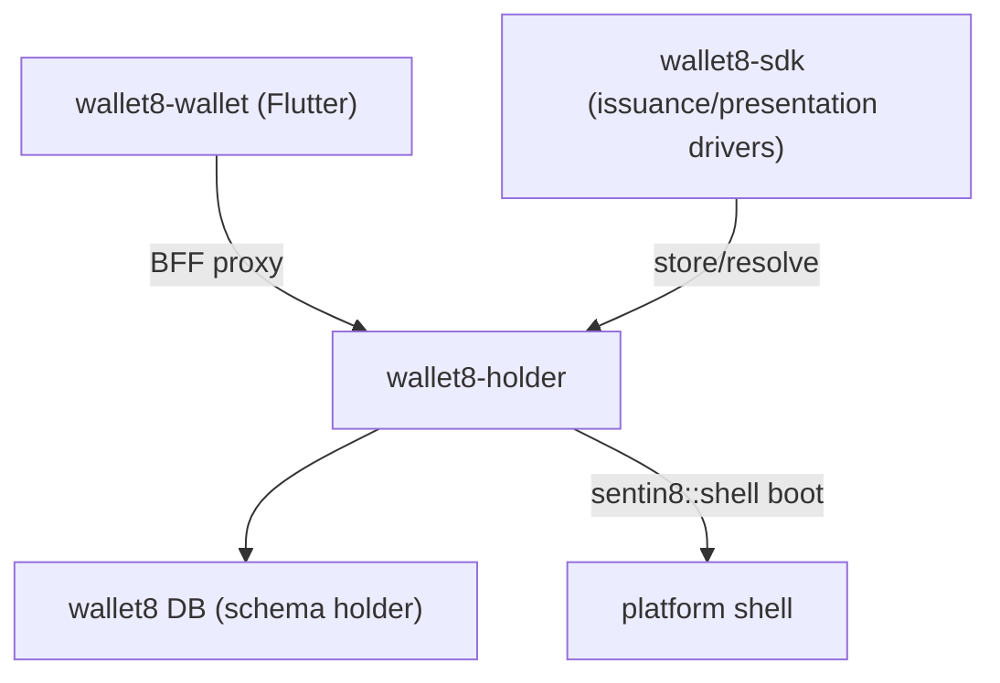
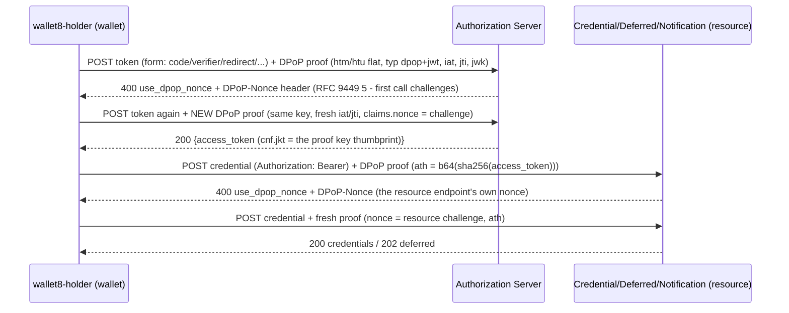

# Wallet8 Holder - Detailed Design Document

## 1. Scope & Context

The holder backend: the encrypted credential vault, the device-key
registry, the presentation history. It owns the wallet's PERSISTED
state; the protocol drivers live in wallet8-sdk (the crates) and
wallet8-flutter (the app).

## 2. Runtime Architecture

The `sentin8-shell` boot: registration flag, PQ provider, config,
the capped pool, state binding, OpenAPI merge, middleware, the PQ-TLS
listener. The service supplies registration (the admin scopes, the
RFW pages, the pg roles, the m2m grants), the state (pool + env + the
vault's data key), and the routes.

## 3. Data Model

The three RLS-forced tables under the service's own `holder` schema
inside the wallet8 vertical database (schema-per-service, DBX §6.6 -
the same layout bank8:ledger's `ledger.*` uses): `holder.credentials`,
`holder.device_keys`, `holder.presentations` - see the vertical
DESIGN.md §3. The credential material column (`credential_ct`) stores
the AES-256-GCM envelope (`sentin8::crypto::seal_str`); the key
derives from the `WALLET8_HOLDER_DATA_KEY` service secret. Every
query is schema-qualified (no search_path dependence).

The vault invariant: `credentials_env_user_idx` - ONE holding per
(env, user). Every vault write (the intake, the complete flow, the
deferred poll) upserts on that key: a renewed issuance REPLACES the
holding in place (`issued_at = now()`), never errors on duplicate -
the wallet's credential is a SLOT, not an append-only log.

## 3a. Spec-first implementation (the governing directive)

The wallet8 SDK clients are implementations of the normative
specifications, section by section. The OIDF conformance suite
VERIFIES behavior; the contracts are the specifications themselves
(the full baseline catalog: the vertical's `BUSINESS.md` §3; the
section-by-section map: the vertical's `DESIGN.md` §3a):

- **OID4VCI 1.0 Final** (16 Sep 2025) - the issuance client: offer
  intake by value/reference (§4.1.2/4.1.3), the metadata identity
  check (§12.2.2), the authorization-server selection (§12.2.4), the
  pre-authorized exchange + tx_code (§6.1), the anonymous form
  (§12.3), the nonce endpoint (§7), the jwt proof (App. F.1), the
  credential endpoint (§8.2/8.3), the deferred form (§9), the
  notifications (§11).
- **OID4VP 1.0 Final** (9 Jul 2025) - the presentation client: the
  request shape gate (§5.1/5.2/8.2), DCQL (§6) with the exact §6.4.1
  claim_sets + §6.4.2 credential_sets selection rules, the claims
  path pointer (§7), the vp_token (§8.1), direct_post (§8.2), the
  error vocabulary (§8.5), the KB-JWT (B.3.6), the B.2.6.1/6.2
  session transcripts, the DC API origins (App. A).
- The vault's own obligations come from the same texts: encrypted
  storage (OID4VCI §15.3), the presentation-history audit (OID4VP
  §15.1), and the status checks (IETF Token Status List draft-14;
  ISO/IEC 18013-7 deferred per the vertical DESIGN.md §10).

Every SDK function cites its section. When a suite check and the
specification disagree, the specification wins - and the suite
finding is re-examined against the text.

## 4. API Surface

See the vertical DESIGN.md §4. Every handler: the RLS context set +
the query on ONE transaction.

## 4a. The conformance-certification orchestration (WALCERT-1)

The OIDF wallet campaign (`oid4vci-1_0-wallet-test-plan`) certifies
THIS service as the system-under-test: the suite plays the MOCK
credential issuer and this holder's SDK consumes the offer and runs
the issuance flow. The orchestration the rig drives:

1. The runner (on the module's WAITING state, once per unserved
   parking marker) POSTs `POST /v1/issuance/prepare {offer_url}` - the
   suite-hosted offer document URL. The intake parses the offer, the
   RFC8414 metadata, pushes the PAR with the authorization_details,
   parks the session (600s), and returns `{session, authorize_url}`.
2. The runner completes the authorize journey (the suite's mock issuer
   serves the authorize endpoint; its browser block or a direct GET
   with the mocked-consent posture delivers the code to the registered
   redirect).
3. The runner POSTs `POST /v1/issuance/complete {session, code, state}`
   - the state check, the PKCE token exchange, the nonce pre-flight,
   the jwt proof, the credential request, the vault store, and the
   notification.

The holder's client identity for the campaign:
`WALLET8_HOLDER_CLIENT_ID` + `WALLET8_HOLDER_CLIENT_JWKS` (the
published EC keys; the plan config's `client.jwks` mirrors them
public-only per the EnsureJwksHasNoPrivateOrSymmetricKeyMaterial
check). The identity rides the plan config's client block - the same
registration the suite validates.

## 4b. DPoP access-token sender-constraining (RFC 9449)

When the AS metadata/advertisement constrains access tokens with DPoP
(the campaign's `dpop` variant; any AS advertising
`dpop_signing_alg_values_supported`), every HTTP call the wallet's
issuance client makes - the token exchange and EVERY
access-token-bearing call after it (credential, deferred, notification)
- carries a DPoP proof JWT (RFC 9449 4.2), and every DPoP-capable
endpoint is exercised against the nonce-challenge posture:

Invariants (all verified by the suite's conditions
`ValidateDpopProof*`/`EnsureDpopProofJtiNotAlreadyUsed`/
`ValidateDpopAccessTokenJkt`/`ValidateDpopProofAccessTokenHash`):

- ONE key. The token-call proof and every resource-call proof sign with
  the SAME wallet device key - the AS binds the access token to that
  key's thumbprint (`cnf.jkt`) and the resource endpoints validate
  the proof `jwk` against it.
- Proof shape. Header `typ: dpop+jwt`, `alg` (ES256), public `jwk`
  (no private material). Claims: flat `htm` + `htu` (the FULL
  request URL - no method/host/scheme object), `iat` (+ `exp`),
  fresh `jti` per attempt, `nonce` when challenged, and `ath` ONLY
  when the call presents the access token (token call: NEVER `ath`).
- Nonce handling. `400 use_dpop_nonce` + `DPoP-Nonce` response header
  is a CHALLENGE, not a failure: the wallet reads the header, caches
  the endpoint-scoped nonce, and retries ONCE with a fresh proof
  carrying it (RFC 9449 8.2: the retry MUST be accepted when the
  nonce matches - a second challenge is a defect). Token, credential,
  deferred, and notification each keep THEIR OWN cached nonce (the
  AS and the resource servers mint independent nonces; the
  suite's `token_endpoint_dpop_nonce_error` /
  `resource_endpoint_dpop_nonce_error` environments are separate).
- The `DPoP` header name is case-normalized by transports; the value
  is the compact JWS. The `authorization` header stays `Bearer` for
  this flow (the mTLS-bound form is a different variant).

Implementation: the SDK owns the mechanics -
`mint_dpop_proof` (the flat RFC 9449 claims), `DpopSession` (the
per-endpoint nonce cache + the challenge-retry wrappers
`exchange_code_dpop` / `post_protected_dpop`), and
`dpop_nonce_from_response` (the `DPoP-Nonce` header read). The
holder orchestrates: it mints NO proofs itself; it passes the
device key + the endpoint URLs and the SDK performs the
challenge-retry round transparently.

## 5. Cross-Cutting Concerns

The Shield gate precedes every handler in the deployed fleet (the BFF
proxy carries the verified user claim); the vault's scoped read
(`GET /v1/credential/{id}`) is the only material-returning surface.

## 6. Failure Modes & Recovery

A sealed-write failure rolls the whole intake back (the issuance flow
retries); a key-derivation failure fails the boot (fail-closed).

## 7. Concurrency & Performance Model

Read-mostly vault; the pool cap 3. The presentation resolve is a
single-row read + an unseal.

## 8. Invariants, Insecure-Defaults Rejected

Ciphertext-only persistence; RLS forced; the thumbprint uniqueness
per env (the same key re-registers idempotently).

## 9. Testing Strategy

The in-crate unit tests (the thumbprint form); the e2e flows through
the BFF proxy.

## 10. Open Questions

The vault's export/import surface (wallet migration between devices) -
deferred.

