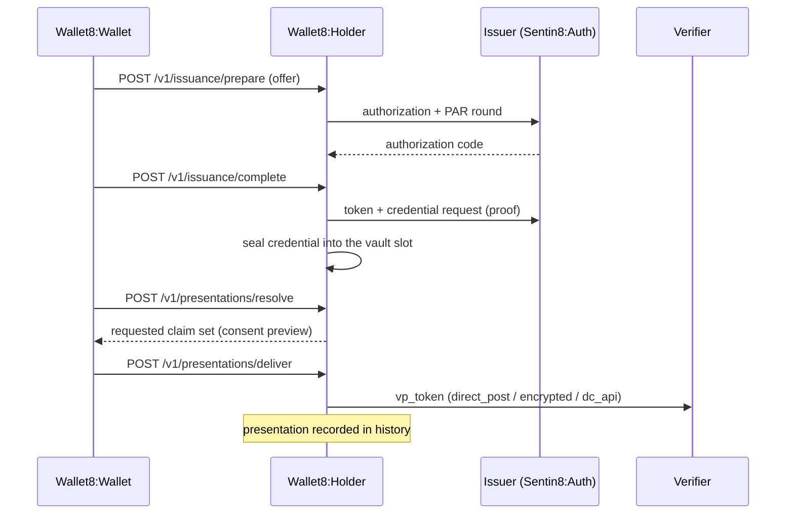

# Wallet8:Holder - the holder backend

The holder backend owns the wallet's persisted state: the encrypted
credential vault, the device-key registry, the presentation history, and
the issuance/presentation orchestration that the app drives.

## Use cases

- **Credential vault** - one credential slot per (environment, user).
  A renewed issuance replaces the holding in place; the vault is a slot,
  not an append-only log.
- **Device-key registration** - the wallet registers its public key once;
  every later proof is sender-constrained by that key.
- **Issuance orchestration** - `prepare` starts an authorization-code
  round, `complete` finishes it; the deferred form polls the issuer's
  deferred endpoint on schedule.
- **Presentation delivery** - resolve a verifier request into the exact
  claim set, then deliver via `direct_post`, the encrypted response
  form, or the DC API channel.
- **Presentation history** - every verification event is recorded for the
  user's own audit duty under OID4VP 1.0 §15.1.
- **Status sync** - walks the Token Status List so a revoked credential
  stops presenting.

## Architecture

The service boots on the platform shell: registration, post-quantum
provider, config, the capped connection pool, state binding, the OpenAPI
merge, middleware, and the PQ-TLS listener. It supplies its registration
(admin scopes, RFW pages, PostgreSQL roles, M2M grants), its state (pool,
environment, and the vault's data key), and its routes.

## Data model

Three RLS-forced tables in the service's own `holder` schema inside the
wallet8 vertical database: `holder.credentials`, `holder.device_keys`,
`holder.presentations`. Credential material is stored as an AES-256-GCM
envelope; the key derives from the service's own secret.

## Full documentation

The complete detail lives in this product's sub-pages and the harvested
reference:

- [Architecture (DDD)](/docs/reference/holder/design) - the full design.
- [Reference](/docs/reference/holder/) - the harvested repository docs.
